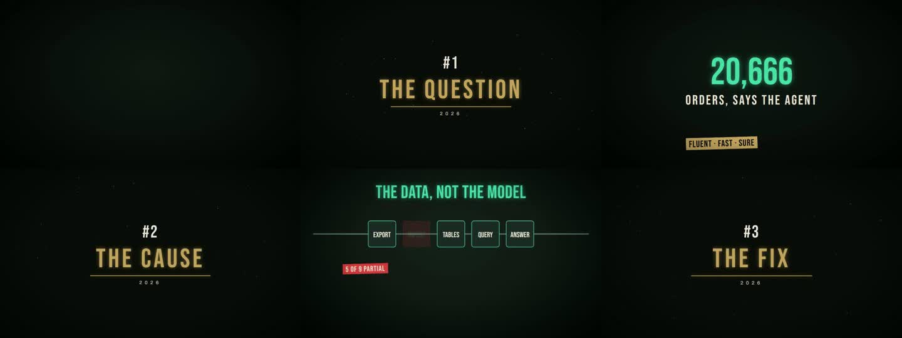

# Explainer Director (working name)

Turn a script into a **narrated, scored, animated explainer video** with Claude Code, on your own machine.
You approve the beat map, the look and a draft before the final render. Built for long videos (5–20 min):
training and e-learning explainers, lesson-by-lesson summaries, business-history stories.



> Status: v0.1 draft, not published yet. See TODO.md.

## What you get
- **video-director** skill: intake → beat map (gate 1) → look check (gate 2) → voice + music → draft (gate 3) → final,
  with story arcs, pacing rules and a long-form story formula.
- **flat-explainer-style** skill: the calm numbered-lesson look (cream + deep teal, icons on cue, chapter cards).
- **engine/**: a Remotion project you copy into your folder. Write `script.txt`; most beats are templates
  (kinetic words, big numbers, bars, maps, process lines, split screens, quotes, dialogue, …), so no scene code.
  - Kokoro voices (free, offline, multi-voice) by default, or ElevenLabs per speaker with your own API key
    (`"elevenlabs:<voice_id>"` in cast.json, `ELEVENLABS_API_KEY` set) — word timings either way, so every pop lands on the spoken word
  - Synthesized, royalty-free score with moods per chapter, sound effects on cue words
  - Pre-render check that every cue word is actually spoken
  - Chapter-cached rendering: a fix re-renders one chapter, not the film
  - Finish pass: film grain, −14 LUFS, BT.709; NVENC when there is an NVIDIA GPU, x264 otherwise

## Runs on modest hardware
Developed on a laptop with a 4 GB GPU and 7 GB RAM. The bundled 71-second example renders as a draft in 79 s.
Long films mix their audio in float32 streams, so 15–20-minute soundtracks don't run out of memory.

## Install
Requirements: Claude Code, Node 18+, Python 3.10+, ffmpeg on your PATH.
```
/plugin install explainer-director --marketplace mdhassan91/explainer-director
```
On older Claude Code versions:
```
/plugin marketplace add mdhassan91/explainer-director
/plugin install explainer-director@explainer-director
```
Then ask Claude: "make a video from this script". On the first run it copies the engine into your folder and runs
`setup.sh` (npm packages, Python packages, the Kokoro voice model ~330 MB, 8 sound effects).

## Licence and credits
MIT, see LICENSE. Fonts (SIL OFL, licence files next to them), voices, sound effects and ideas this builds on: CREDITS.md.
Remotion is free for individuals and small companies; larger companies need a Remotion company licence.
